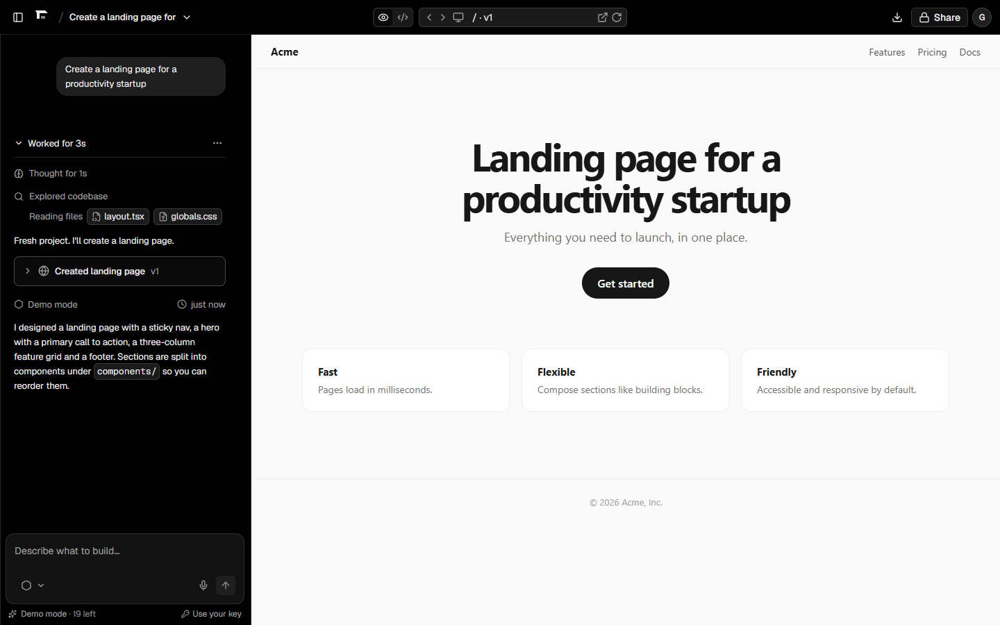
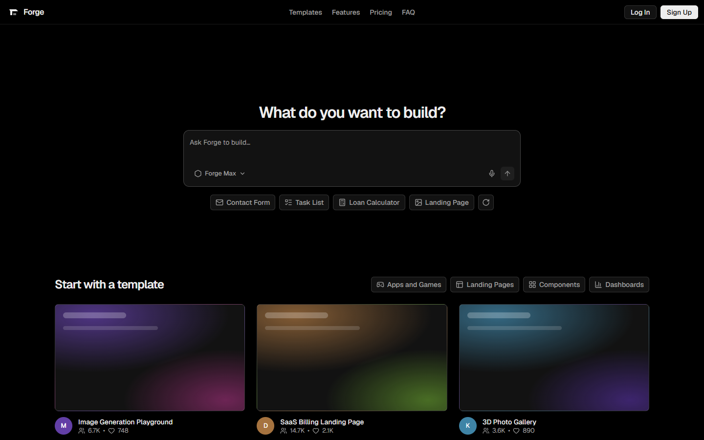
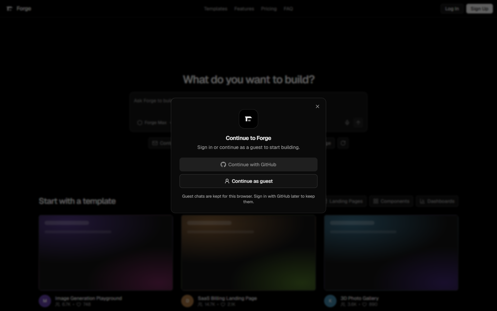
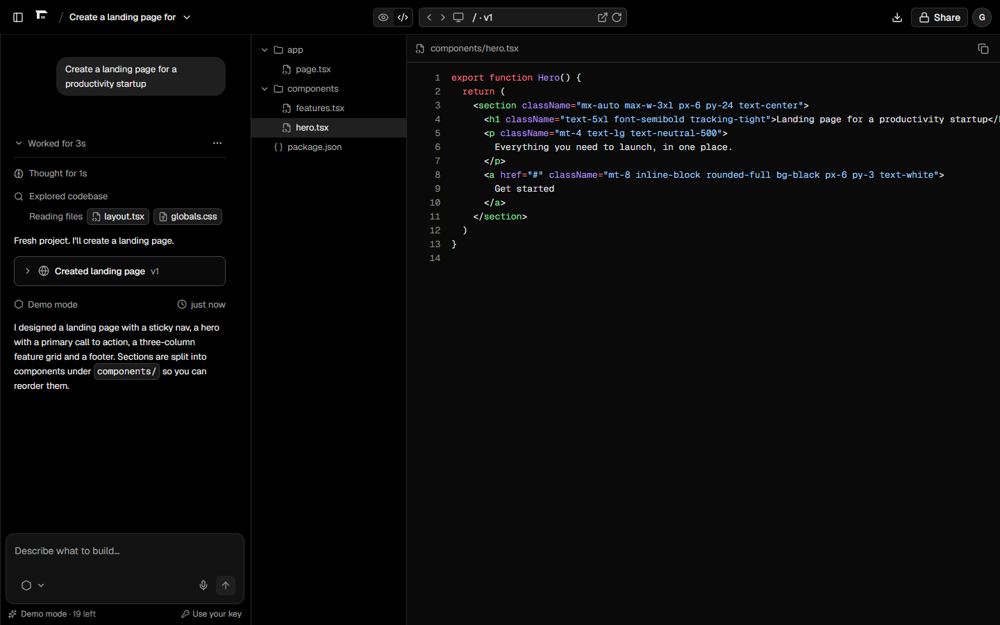
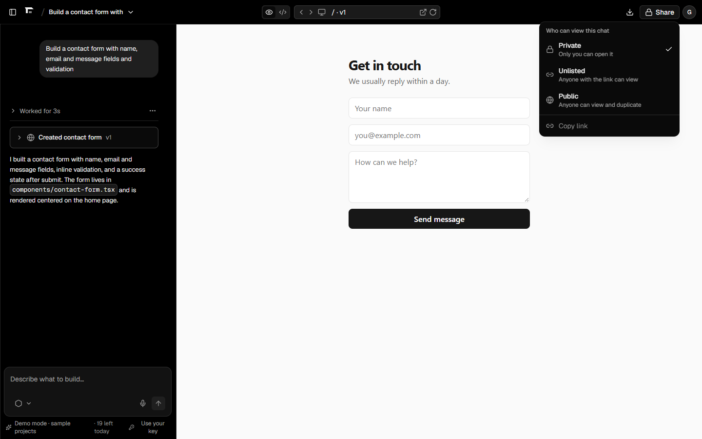
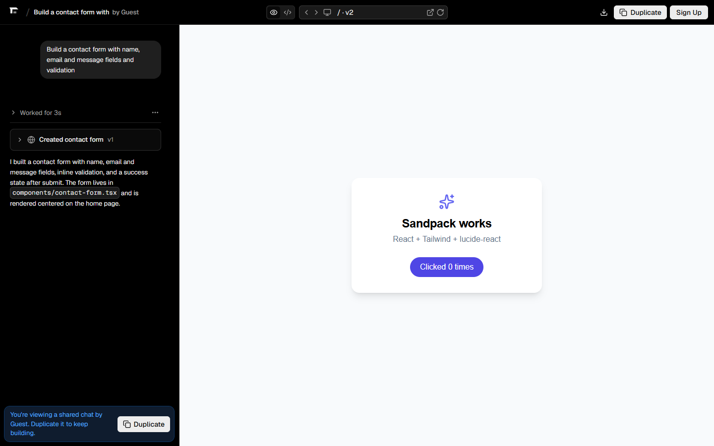
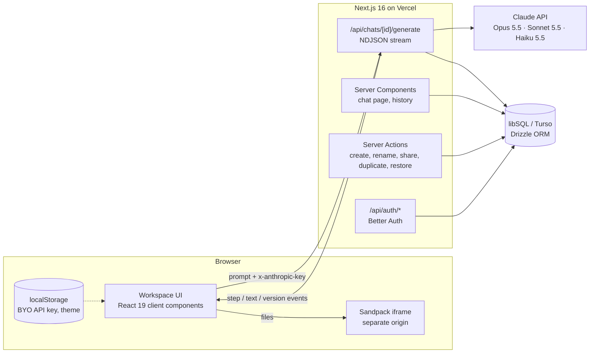

# Forge

**Describe an app, watch it get built.** Forge is an AI app builder inspired by v0: you type a prompt, an agent streams its work step by step, and you get a live preview, versioned source code, and a shareable link.

> Portfolio project. Its interface was studied from v0's public UI ([case study](docs/case-study.md)) and rebuilt from scratch with original branding and code. Not affiliated with Vercel or v0.



## Features

- **Streaming agent turns.** "Thinking → explored codebase → wrote files → summary" streams over NDJSON, with collapsible steps and a version card per turn.
- **Real generation with Claude.** Claude Opus 5.5 (default), Sonnet 5.5 and Haiku 5.5 behind a model picker, using streamed tool use (`write_file`) with validated, sandboxed paths.
- **Free demo mode.** With no API key, a demo engine streams the same protocol with sample projects, so the live demo works for everyone at zero cost.
- **Bring your own key.** Visitors can paste an Anthropic key. It stays in their browser and is sent per request, never stored.
- **Live preview.** Generated React apps run in [Sandpack](https://sandpack.codesandbox.io/) (Tailwind + lucide-react) on a separate origin. Demo apps render in a sandboxed `srcdoc` iframe. Device sizes are desktop, tablet and mobile.
- **Code view.** File tree plus Shiki syntax highlighting, light and dark.
- **Versions.** Every turn creates v1, v2, v3… You can view any version or restore it as the latest.
- **Auth.** GitHub OAuth or one-click guest accounts ([Better Auth](https://better-auth.com)). Guests who later sign in keep their chats.
- **Sharing.** Private, unlisted or public per chat. Others get a read-only view and can **Duplicate** it into their own account.
- **History sidebar, rename, delete, ZIP export** (React projects export as a runnable Vite app).
- **Guardrails.** Per-user daily limits, a capped server-key budget, one generation at a time per chat, auth rate limiting, security headers, and `noindex` on user content.
- **Polish.** Geist type scale and design tokens, light/dark/system theme without a flash, resizable panels, responsive layout (Chat/Preview tabs under 1280px), accessible roles and labels.

| Landing | Sign in | Code view |
|---|---|---|
|  |  |  |
| **Sharing** | **React preview (Sandpack)** | |
|  |  | |

## Architecture



**Generation flow.** `POST /api/chats/:id/generate` checks the session, ownership, the concurrency lock and daily quota. It then picks an engine: the visitor's key, then the server key (capped per user per day), then the demo engine. The response is a stream of typed events (`src/lib/engine/events.ts`) that the client applies to its local copy of the chat, while the server persists the final message, the new version and a usage row. Closing the stream (Stop) aborts the engine.

**Claude engine** (`src/lib/engine/claude.ts`):
- **Loop:** a streaming manual agentic loop with one tool, `write_file`, using `eager_input_streaming` so file names appear as they're written.
- **Validation:** every tool input is validated with Zod. Paths are normalized and confined to the project (no `..`, hidden files or unknown extensions).
- **Stop reasons:** `refusal` and `max_tokens` are checked before any tool runs.
- **Caching:** the system prompt and tools are a stable, cached prefix.
- **Refusal fallback:** enabled with `fallbacks: "default"`.
- **Cost:** each turn's cost is computed from token usage.

## Tech stack

Next.js 16 (App Router, Cache Components, Server Actions) · React 19 · TypeScript · Tailwind CSS v4 · Radix UI · Tiptap · react-resizable-panels · Shiki · Sandpack · Better Auth · Drizzle ORM · libSQL/Turso · Anthropic SDK · Zod · Vitest · Playwright · GitHub Actions

## Getting started

Requires Node 24+.

```bash
npm install
cp .env.example .env.local   # optional: everything has local defaults
npm run dev                  # creates ./data/forge.db and runs migrations first
```

Open http://localhost:3000, type a prompt, choose **Continue as guest**, and the demo engine builds an app. To use Claude, add your key under **Settings & API key** in the account menu, or set `ANTHROPIC_API_KEY` on the server.

| Variable | Purpose | Default |
|---|---|---|
| `DATABASE_URL` / `DATABASE_AUTH_TOKEN` | libSQL database (file or Turso) | `file:./data/forge.db` |
| `BETTER_AUTH_SECRET` / `BETTER_AUTH_URL` | Session signing and public URL | dev secret / request origin |
| `GITHUB_CLIENT_ID` / `GITHUB_CLIENT_SECRET` | Enables "Continue with GitHub" | disabled |
| `ANTHROPIC_API_KEY` | Optional server key for signed-in (non-guest) users | demo mode |
| `SERVER_KEY_DAILY_LIMIT` | Server-key generations per user per day | `5` |
| `DAILY_GENERATION_LIMIT` | All generations per user per day (guests: max 20) | `50` |

## Scripts

| Command | What it does |
|---|---|
| `npm run dev` / `build` / `start` | Develop, build, serve |
| `npm run lint` / `typecheck` | ESLint, `tsc` with generated route types |
| `npm test` | Vitest unit tests (engine loop against a fake Claude SSE server, stream parsing, path safety, export) |
| `npm run test:e2e` | Playwright: guest flow, preview, code view, follow-up, restore, private/unlisted sharing, duplicate, responsive layout |
| `npm run db:generate` / `db:migrate` / `db:studio` | Drizzle migrations and studio |

CI (`.github/workflows/ci.yml`) runs lint, typecheck, unit tests, build and the e2e suite on every push.

## Deploying

See [DEPLOY.md](DEPLOY.md) for Vercel + Turso + GitHub OAuth, step by step.

## Project structure

```
src/
  app/                    routes, server actions, API routes (generate, usage, auth)
  components/
    composer/             Tiptap prompt editor + model picker
    workspace/            header, chat panel, agent turns, preview, code view, history
    auth/                 sign-in dialog, user menu, settings
    ui/                   button, menu, dialog, segmented tabs
  db/                     Drizzle schema (auth + chats/messages/versions/generations)
  lib/
    engine/               generation protocol, Claude engine, demo engine, model map
    chats.ts              data access layer (ownership + visibility checks)
    auth.ts               Better Auth config
tests/unit, tests/e2e     Vitest and Playwright
drizzle/                  SQL migrations
```

## License

MIT. Forge is an independent project; "v0" and "Vercel" are trademarks of Vercel Inc.
